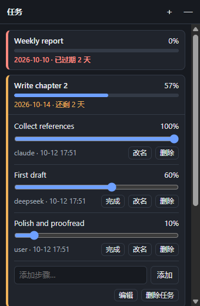

# taskboard

[English](#english) · [中文](#中文)



## 中文

一个常驻桌面的任务小窗口，加一个 `task` 命令。你在窗口里手动改进度，Claude Code、DeepSeek Harness 这类编码 Agent 用命令改进度，大家改的是同一份数据，窗口会显示每一步最后是谁更新的。

- 任务带截止日期，过期和三天内到期的会用颜色和文字标出来。
- 每个任务可以拆成步骤，每一步有 0–100 的进度；任务总进度是各步骤的平均值。
- 数据是你电脑上的一个 JSON 文件，不联网，没有账号。
- 多个进程同时更新不会互相覆盖。

### 状态

第一个版本。只在 Windows 11 上测试过；代码没有使用 Windows 专有接口，但 macOS 和 Linux 未经测试。界面文字是中文，命令行输出是英文。

### 安装

需要 [Node.js](https://nodejs.org/) 22 或更高版本和 Git。

```
git clone https://github.com/zyz122302-lang/taskboard.git
cd taskboard
npm install
npm link
```

`npm link` 会注册两个全局命令：`task`（命令行）和 `taskboard`（启动小窗口）。

### 小窗口

```
taskboard
```

- 窗口没有边框，始终在其他窗口上面；拖动顶部的标题栏移动它，位置会被记住。
- 点任务展开步骤；拖滑块改进度，或点"完成"。
- 点右上角的"—"隐藏窗口，点系统托盘里的图标恢复。
- 右键托盘图标可以开关"开机自动启动"或退出。
- 只用键盘也能操作：Tab 移动，空格或回车展开任务，方向键调整进度。

开机自启记录的是源码目录的位置，移动目录后需要重新开启一次。

### 命令行

```
task add "写论文第二章" --due 2026-10-20     # 创建任务，输出编号
task step add 1 "收集文献"                   # 给任务 1 加步骤，输出步骤编号
task progress 1 1 60                         # 任务 1 的步骤 1 设为 60%
task done 1 1 --by claude                    # 标记完成，并注明是谁做的
task progress 2 40                           # 没有步骤的任务可以直接设进度
task list                                    # 所有任务
task show 1                                  # 一个任务及其步骤
task show 1 --json                           # 机器可读输出
task edit 1 --name "新名字" --no-due         # 改名、去掉截止日期
task step rename 1 1 "新步骤名"
task step rm 1 1
task rm 1
```

截止日期写成 `YYYY-MM-DD` 或 `"YYYY-MM-DD HH:mm"`（本地时间）；只写日期表示当天结束前。

`--by` 说明更新是谁做的。不写时取环境变量 `TASKBOARD_ACTOR`，再没有就记为 `user`。在窗口里做的修改记为 `user`。

失败时命令以非零状态退出，原因写到标准错误。

### 让 Agent 更新进度

安装 taskboard 不会改动你的任何 Agent 配置。接入方法见 [docs/agent-integration.md](docs/agent-integration.md)，模板在 [integrations/](integrations/)。

### 数据

数据在用户主目录下的 `.taskboard/tasks.json`（Windows 上是 `C:\Users\<你>\.taskboard\`）。设置环境变量 `TASKBOARD_HOME` 可以换位置。同一目录下的 `widget.json` 只记录窗口位置。

请不要在 taskboard 运行时手动编辑 `tasks.json`。如果文件损坏，命令和窗口都会拒绝写入并告诉你文件路径，原文件不会被动。

### 已知限制

- 每一步只记录最后一次更新的人和时间，没有完整的修改历史。
- Agent 是否更新进度取决于它是否遵守接入说明，这是软约束。
- 没有到期提醒通知，没有多设备同步。
- 没有安装包，需要从源码运行。

### 开发

```
npm test        # 全部测试
npm run lint    # ESLint
npm start       # 启动小窗口
```

需求和设计在 `openspec/` 下，用 [OpenSpec](https://github.com/Fission-AI/OpenSpec) 管理。提交前钩子会运行测试和 lint。

## English

A small always-on-top desktop window plus a `task` command. You change progress in the window; coding agents such as Claude Code and DeepSeek Harness change it from the command line. Everyone edits the same data, and the window shows who last updated each step.

- Tasks have due dates. Overdue tasks and tasks due within three days are marked with colour and text.
- A task can be split into steps, each with 0–100 progress. Task progress is the average of its steps.
- The data is one JSON file on your machine. No network, no account.
- Several processes can update at once without overwriting each other.

### Status

First release. Tested on Windows 11 only. The code avoids Windows-only APIs, but macOS and Linux are untested. The window's text is in Chinese; command-line output is in English.

### Install

Requires [Node.js](https://nodejs.org/) 22 or later and Git.

```
git clone https://github.com/zyz122302-lang/taskboard.git
cd taskboard
npm install
npm link
```

`npm link` registers two global commands: `task` (the CLI) and `taskboard` (starts the window).

### The window

```
taskboard
```

- Frameless and always on top. Drag the title bar to move it; the position is remembered.
- Click a task to see its steps. Drag a slider to change progress, or click "完成" (done).
- "—" hides the window; click the tray icon to bring it back.
- Right-click the tray icon to toggle start-at-login or to quit.
- Fully usable from the keyboard: Tab to move, Space or Enter to expand, arrow keys to adjust progress.

Start-at-login stores the location of the source directory. Turn it on again if you move the directory.

### Command line

```
task add "Write chapter 2" --due 2026-10-20   # create a task, prints its id
task step add 1 "Collect references"          # add a step to task 1, prints the step id
task progress 1 1 60                          # set step 1 of task 1 to 60%
task done 1 1 --by claude                     # mark it done and say who did it
task progress 2 40                            # a task without steps takes progress directly
task list                                     # all tasks
task show 1                                   # one task with its steps
task show 1 --json                            # machine-readable
task edit 1 --name "New name" --no-due        # rename, clear the due date
task step rename 1 1 "New step name"
task step rm 1 1
task rm 1
```

Due dates are `YYYY-MM-DD` or `"YYYY-MM-DD HH:mm"` in local time. A date without a time means the end of that day.

`--by` records who made the update. Without it the CLI uses the `TASKBOARD_ACTOR` environment variable, then `user`. Changes made in the window are recorded as `user`.

On failure the command exits non-zero and writes the reason to standard error.

### Letting agents update progress

Installing taskboard does not change any agent configuration. See [docs/agent-integration.md](docs/agent-integration.md); the templates are in [integrations/](integrations/).

### Data

Data lives in `.taskboard/tasks.json` in your home directory. Set `TASKBOARD_HOME` to use another location. `widget.json` next to it only stores the window position.

Do not edit `tasks.json` by hand while taskboard is running. If the file is damaged, both the CLI and the window refuse to write, tell you the path, and leave the file untouched.

### Known limitations

- Each step records only its last update (who and when), not a full history.
- Whether an agent updates progress depends on it following the integration notes.
- No due-date notifications and no sync between devices.
- No installer; it runs from source.

### Development

```
npm test        # all tests
npm run lint    # ESLint
npm start       # start the window
```

Requirements and design live in `openspec/`, managed with [OpenSpec](https://github.com/Fission-AI/OpenSpec). The pre-commit hook runs tests and lint.

## License

[MIT](LICENSE)
